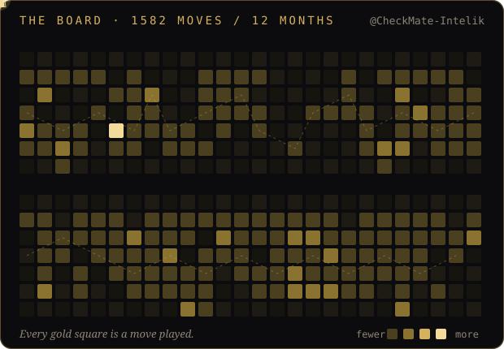

 

## About

Tech Lead and founding team member at Intelik. I design, build and ship software end to end: from the first architecture sketch to production, across web, mobile and backend.

## Tech stack

## Selected work

- **[Consumer Lending Platform](https://www.faezsiddiqui.com/projects/consumer-lending/)**: end-to-end lending workflows.
- **[Document Intelligence](https://www.faezsiddiqui.com/projects/document-intelligence/)**: extraction from scanned documents.
- **[Dealership Management System](https://www.faezsiddiqui.com/projects/dealership-management-system/)**: inventory, sales and customers.
- **[Prism ERP](https://www.faezsiddiqui.com/projects/prism-erp/)**: modular ERP for operations teams.
- **NeXCasH**: peer-to-peer lending and payments app I founded; selected for the first cohort of the IBA CED I-INCUBATE program.

More case studies on my [portfolio](https://www.faezsiddiqui.com).

## The board

## Let's talk

[Portfolio](https://www.faezsiddiqui.com) · [LinkedIn](https://www.linkedin.com/in/muhammad-faez-siddiqui/) · [WhatsApp](https://wa.me/923392464826) · [Email](mailto:mo.faez.sidd@gmail.com)
